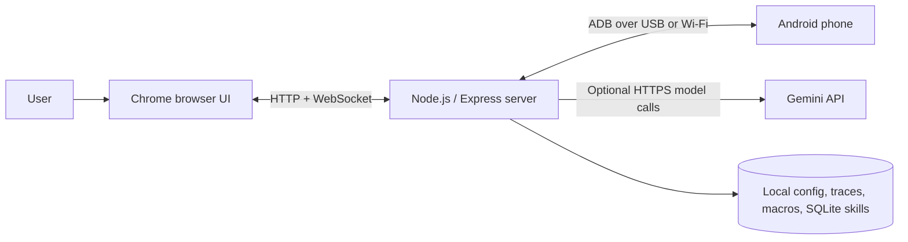

# NexusFlow — Vani Autopilot

**Tell your phone what you want. It looks at the screen and does it.**

NexusFlow drives a real Android phone from your PC over ADB. Its headline
feature is **Vani Autopilot**: an autonomous agent that *reads the live screen*
(UI hierarchy + screenshots), plans, taps, types, verifies each step, recovers
when it gets stuck, and stops before anything irreversible to ask you first.

Node.js + Express + WebSocket, plain-JS frontend, ADB underneath. **No build
step, no framework, and no SDK for the model either** — the Gemini provider is
~200 lines of `fetch`. Three runtime dependencies in total (express, ws,
multer), none of them for the agent.

### Quick navigation

- [What it does and how the agent works](#why-this-is-different)
- [Install and run locally](#setup)
- [Deployment analysis and readiness](#deployment-analysis)
- [PPT-ready slide outline](#ppt-ready-project-outline)
- [Security, tests, and project layout](#security-model)

---

## Why this is different

Most phone assistants can only do what someone pre-wired. NexusFlow's classic
pipeline is exactly that — ~30 hard-coded intents (`CALL`, `OPEN_APP`,
`FLASHLIGHT`…). Autopilot is not:

|  | Classic intent pipeline | **Vani Autopilot** |
|---|---|---|
| Knows about | 30 pre-written actions | whatever is on screen |
| Sees the phone | no | UI element tree + screenshots, every step |
| New app / new screen | needs code | just works |
| Recovers from a wrong tap | no | verifies, replans, retries differently |
| Cost of a task | free | a few cents, hard-capped |

It composes **10 primitives** — `tap_element` · `tap_xy` · `type_text` ·
`swipe` · `press_key` · `open_app` · `wait` · `screenshot` · `ask_user` ·
`finish` — against what it can actually see. That is the whole action space.

---

## The loop

```
        ┌──────────── bounded by steps / cost / your STOP button ────────────┐
        │                                                                    │
        │  PERCEIVE   uiautomator dump + screencap → numbered element list    │
        │      ↓                                                             │
        │  PLAN       subgoals up front; replan when stuck                    │
        │      ↓                                                             │
        │  ACT        model picks ONE primitive → safety gate → ADB           │
        │      ↓                                                             │
        │  VERIFY     did the screen actually change? closer to the goal?     │
        │      └──────────────────────── loop ────────────────────────────────┘
                                    ↓
                     trace: every thought, action and screenshot
                                    ↓
                     "Save as macro" → replays with no AI call
```

The agent sees the screen as a numbered list it can address precisely:

```
Screen 1080x2400 · app: com.android.settings
Elements (index, kind, label, normalized centre):
#0 [text]   "Settings"            (0.21,0.09)
#1 [button] "Search settings"     (0.50,0.15) {clickable}
#2 [button] "Network & internet"  (0.39,0.22) {clickable}
#3 [toggle] "Airplane mode"       (0.86,0.29) {clickable,unchecked}
```

…so it taps `#3`, not a guessed pixel. When a screen refuses to dump (secure
screens, animations) it falls back to vision and coordinates automatically.

---

## Safety

The agent drives a phone with a real SIM and real payment apps, so **every
action is classified before it runs**:

| Verdict | What happens | Examples |
|---|---|---|
| `safe` | runs immediately | scrolling, opening apps, ordinary taps |
| `confirm` | you get a one-tap prompt first | "Place order", "Send", "Delete", "Call", any tap inside a payments app or on a checkout screen — in English *or* Hinglish (`bhejo`, `kharido`) |
| `block` | never runs; the agent must ask you | typing into a password field, filling an OTP / PIN / CVV |

Plus:

- **DRY RUN** — the agent goes right up to the irreversible step, narrates what
  it *would* have tapped, and stops. The way to demo a checkout safely.
- **STOP** — always live; halts within one step.
- **Budget caps** — a step limit and a token/cost cap, shown on a live meter.
- **Request pacing** — the free tier limits requests per minute, so the provider
  throttles itself and backs off on 429 rather than dying mid-run.
- **App allowlist** — optionally restrict the agent to named packages.

The agent never invents screen contents: it can only report what is in the
element list or the screenshot.

---

## Setup

Requires **Node.js ≥ 22.13** for the built-in `node:sqlite` skill store, plus
Windows for the current ADB auto-installer. (Node 22.5–22.12 can run with
`--experimental-sqlite`; Node 20 cannot import `node:sqlite`.)

`ffmpeg` on `PATH` is optional: with it the mirror is real-time video, without it
the mirror falls back to the ~3 fps frame poller and everything else is unchanged.

```bash
npm ci
```

On Windows PowerShell, copy the environment template and add your key to `.env`:

```powershell
if (-not (Test-Path .env)) { Copy-Item .env.example .env }
# Edit .env and set GEMINI_API_KEY=your_key
npm start                 # http://localhost:3000
```

On macOS/Linux, use `cp .env.example .env` in place of `Copy-Item`. The
current auto-installer downloads Windows ADB tools; other operating systems
need ADB installed and on `PATH`, and should be validated before deployment.

The key is **free** — get one at
[aistudio.google.com/apikey](https://aistudio.google.com/apikey). The default
model is `gemini-3.8-flash`, Google's Flash model aimed at long-horizon agentic
work.

### No key? Run the whole thing anyway

```bash
NEXUSFLOW_AI_PROVIDER=mock npm start     # PowerShell: $env:NEXUSFLOW_AI_PROVIDER='mock'
```

The **mock provider** replaces only the model's *decisions* with a short script.
Everything else is real: it opens apps, taps real elements, captures
screenshots, writes a trace, and obeys the safety gate. Use it to rehearse a
demo without touching your quota, or as a fallback when the network is against
you.

Connect an Android phone by USB with **USB debugging** enabled and accept the
RSA prompt. Chrome is used because the voice features need the Web Speech API.

### Connecting without a cable

**SETTINGS → WIRELESS ADB MODE** flips a phone that is *already* on USB over to
Wi-Fi (`tcpip 5555`) so you can unplug it. Many Android 11+ builds refuse that
port, so there is a second path that never needs a cable at all:

**SETTINGS → PAIR OVER WI-FI.** On the phone, Developer options → *Wireless
debugging* → on → *Pair device with pairing code*. Type that dialog's address
and 6-digit code into the two boxes and hit **PAIR DEVICE**; then enter the
*IP address & Port* from the top of the Wireless debugging screen — a different
port — and hit **CONNECT**.

Both halves are one-shot and change every time the dialog is reopened or
Wireless debugging is toggled, so read them fresh each time. Pairing needs
someone at the phone reading the code off its screen, which is the whole
consent model — it cannot be done to a phone you are not holding.

Open the **⚡ AUTOPILOT** tab and type or speak a task:

- *"airplane mode on kar do"*
- *"open YouTube and search for lofi beats"*
- *"change the screen timeout to 30 seconds"*

Watch the phone frame: numbered boxes appear over every element, the one the
agent is about to tap glows green, and a ripple shows where the tap landed.

---

## Benchmark

Because "it works" is not a number:

```bash
npm run bench             # needs a phone connected + GEMINI_API_KEY
npm run bench -- airplane # just the matching tasks
```

Eight scripted tasks, each with a **programmatic checker** that reads device
state over ADB — the agent never sees the checker. Prints per-task pass/fail,
steps, wall-time and cost, then the headline success rate. Every task is
non-destructive and restores the phone afterwards.

---

## Learn once, replay forever

**The agent remembers what worked.** Every successful run is distilled into a
*skill* and kept in a local SQLite library (`node:sqlite` — built into Node, so
still three runtime dependencies). The next time the same task comes in, the
model is never called at all:

| | |
|---|---|
| **exact** | The task fits a learned template → replay the recording. **Zero AI calls**, no cost. |
| **similar** | Nothing fits, but related runs exist → they go into the planning prompt as worked examples, so the model starts from what worked instead of from nothing. |

Two things make the recall hold up:

- **Skills take arguments.** "search for lofi beats" and "search for tabla solo"
  are one skill. Whatever the user *typed* becomes a parameter; tap labels and
  app names deliberately do not — a different app is a different screen, and a
  button label that happens to echo a word in the task is a coincidence, not a
  variable.
- **Taps re-resolve by label, not by pixel.** A recording taps "Airplane mode"
  wherever it is *now*. If the label is gone the screen has genuinely changed,
  and replay says so instead of tapping whatever moved into that spot.

Matching is semantic, so memory survives a language switch — "airplane mode on
kar do" recalls for "turn on aeroplane mode" (82% similar, measured), which no
keyword index would do.

The safety classifier runs on every replayed step exactly as it does in the
loop: a recording is not a licence. A skill that keeps failing stops being
trusted and the agent works the task out again from scratch, replacing it.

`GET /api/skills` lists what has been learned; `DELETE /api/skills/:id` forgets
one. Memory is opt-in at the call site — `runAgentTask` remembers nothing unless
the caller passes the library — so the tests and the benchmark can measure the
agent with it and without it.

The manual path still exists: **★ SAVE AS MACRO** freezes a trace into a fixed
macro.

Past runs are browsable (**PAST RUNS**) with per-step screenshots and the
agent's reasoning at each step.

---

## Everything else it still does

| Area | |
|---|---|
| **Classic pipeline** | Natural-language commands (English / Hindi / Hinglish) → intent → ADB, for the things you want instant and free. |
| **Voice** | Web Speech with a 5-best transcript list, Hinglish phonetic normalization, fuzzy contact matching, `हिं / EN` toggle. On the Autopilot tab, speaking drives the agent. |
| **Vani chat** | The original tool-use assistant over the fixed action registry. |
| **Macros** | Save and run command sequences — now also learned agent runs. |
| **Live mirror** | Real-time video (`screenrecord` H.264 → ffmpeg → MJPEG over the WebSocket), ~30 fps while the screen moves. Falls back to the ~3 fps frame poller when ffmpeg is missing, and the poller covers the stream's ~4 s warm-up either way. |
| **Full phone control** | Click → tap, drag → swipe, hold → long-press, wheel → scroll, right-click → back, middle-click → home. A key bar for back / home / recents / volume / power, and PC keyboard passthrough — focus the frame and what you type goes to the phone. |
| **Resizable mirror** | Drag the grip to resize, ▬ to collapse, ⛶ to maximize into a full-screen overlay (Esc to close). |
| **Files** | Browse `/sdcard`, upload, download, delete, mkdir. |
| **Apps** | Install an APK, list and uninstall packages. |
| **Recording** | Record the phone screen to MP4. |
| **Auto-unlock** | Unlock a PIN-locked phone automatically on USB connect. |

---

## Security model

By default the server is **localhost-only** — any request from another machine
is refused for both the REST API and the WebSocket.

To allow LAN or tunnel access, set a shared token:

```
NEXUSFLOW_AUTH_TOKEN=<a long random string>
# NEXUSFLOW_ALLOWED_ORIGINS=http://localhost:3000,http://192.168.1.20:3000
```

Every `/api/*` call then needs `Authorization: Bearer <token>`, every WebSocket
upgrade needs `?token=<token>`, and browser origins are checked against the
allowlist. Rate limits apply throughout.

Other guarantees:

- Every ADB call carrying user input goes through `execFile` with an argument
  array — no shell, no command injection.
- Trace ids are validated against path traversal before touching the filesystem.
- Screenshots, mirror frames and traces live in `server/.runtime/` (gitignored)
  and are served only behind the auth gate — never from `public/`.
- `config.json` (which can hold the unlock PIN) is gitignored; the PIN is never
  sent to the browser.
- `POST /api/agent/run` has no socket to prompt on, so it **declines** every
  action that needs confirmation rather than auto-approving it.

**Do not expose this to the internet without `NEXUSFLOW_AUTH_TOKEN` and HTTPS**
(a TLS reverse proxy or a private tunnel such as `cloudflared`).

---

## Environment variables

| Var | Default | Purpose |
|---|---|---|
| `PORT` | `3000` | HTTP port |
| `GEMINI_API_KEY` | — | enables Autopilot + the Vani chat (free, from AI Studio) |
| `NEXUSFLOW_AI_MODEL` | `gemini-3.8-flash` | model for both. **On the free tier set `gemini-3.6-flash`** — 3.8's daily allowance is ~20 requests, and one agent run costs 5-10 |
| `NEXUSFLOW_AI_PROVIDER` | `gemini` | `mock` = scripted decisions, no key, no network |
| `NEXUSFLOW_AUTH_TOKEN` | — | unset = localhost-only; set = bearer-token auth |
| `NEXUSFLOW_ALLOWED_ORIGINS` | `http://localhost:3000`, `http://127.0.0.1:3000` | WebSocket origin allowlist |
| `NEXUSFLOW_NO_BROWSER` | — | `1` = don't auto-launch Chrome |

Agent limits (steps, cost cap, dry run, app allowlist, requests-per-minute) live
in the Settings tab and `server/config.json`, not in env vars.

---

## Deployment analysis

### Recommended deployment model

NexusFlow is currently a **local Windows application that controls a nearby
Android phone**, rather than a public cloud service. Run the Node.js server on
the PC that can reach the device over USB or Android Wireless Debugging. The
browser UI talks to that server over HTTP and WebSocket. Gemini is an optional
external HTTPS dependency for AI decisions; the classic command pipeline and
mock provider do not need Gemini.



### What is deployable today

| Area | Current state | Deployment implication |
|---|---|---|
| App runtime | Node.js server serves the static UI, REST API, and WebSocket on `PORT` (default `3000`). | No frontend build step; use `npm ci` and `npm start`. |
| Device link | ADB controls the Android device over USB or Wireless Debugging. | The PC running the app must be able to reach the phone; device pairing requires user action on the phone. |
| ADB setup | The fallback downloader fetches Google's Windows platform-tools ZIP and extracts it with PowerShell. | Windows is the supported automatic setup. On other OSes, install ADB yourself and validate the full device flow. |
| AI | Gemini needs `GEMINI_API_KEY` and internet access; mock mode removes the model dependency. | Keep the key on the local server in `.env`; never put it in browser code or a public repository. |
| State | Config, contacts, macros, traces, and skill memory are written to local files under `server/` (SQLite skills and traces under `server/.runtime/`). | Keep these paths on persistent storage and back them up if user data must survive reinstall or machine replacement. |
| Cloud packaging | No Dockerfile, container manifest, or cloud deployment workflow is present. | A generic cloud VM/serverless host cannot directly control a USB-attached phone. A cloud UI would need a separately designed local device relay. |
| CI | GitHub Actions runs the test suite on Node 20.x and 22.x. | The Node 20 matrix entry conflicts with the static `node:sqlite` import; use Node 22.13+ and align CI before calling Node 20 supported. |

### Local deployment steps (Windows)

1. Install Node.js 22.13 or newer and Chrome. Connect an unlocked Android phone,
   enable **USB debugging**, and accept its RSA prompt. Wireless ADB is also
   available from the app's Settings screen.
2. From the repository folder, run:

   ```powershell
   node --version
   npm ci
   if (-not (Test-Path .env)) { Copy-Item .env.example .env }
   ```

3. Edit `.env` and set `GEMINI_API_KEY` to enable Gemini. For a live-device demo
   without a model key, set `NEXUSFLOW_AI_PROVIDER=mock` in `.env` instead.
4. Start the app with `npm start`, then open `http://localhost:3000` if Chrome
   does not open automatically. Check `http://localhost:3000/api/health` for
   server, AI, and device status.
5. Before a presentation, run the scenarios in [`docs/demo.md`](docs/demo.md).
   Use dry-run for checkout or other irreversible actions and keep a backup
   recording of the demo.

### Remote access and release readiness

- The intended baseline is one trusted PC and a phone controlled by its owner.
  Keep the default local workflow for classroom or lab demos.
- For LAN access, configure `NEXUSFLOW_AUTH_TOKEN` and
  `NEXUSFLOW_ALLOWED_ORIGINS`; place the service behind HTTPS before using it
  across an untrusted network. Do not publish the raw development server to the
  public internet.
- API and WebSocket control paths enforce local-only access when no token is
  configured. The static browser assets are served separately, so a production
  remote deployment should also bind the service to a trusted interface or
  protect the full site at a TLS reverse proxy.
- Persist and protect `.env`, `server/config.json`, contacts, macros, traces,
  uploads, downloads, and `server/.runtime/`. These may contain API credentials,
  device data, or user-generated content; `.gitignore` excludes them from Git.
- Before calling this production-ready, align the CI Node version with the
  SQLite runtime requirement, document a supported non-Windows ADB setup (if
  desired), and define backup, log retention, and update procedures.

For deployment questions in a presentation, the short answer is: **run the
server beside the phone; use Gemini only as an optional remote model; do not
present this repository as a cloud-hosted service today.**

---

## PPT-ready project outline

This outline provides slide titles, key talking points, and visual suggestions.
Use the real benchmark output from `npm run bench` for measured success or cost
figures; this README does not claim a benchmark result that has not been run.

### Slide 1 — NexusFlow: Vani Autopilot

- **Message:** Control a real Android phone from a PC using natural language.
- **Subtitle:** Screen-aware automation with verification and human control.
- **Visual:** Project name, phone screen mirrored beside the desktop UI.
- **Presenter line:** “NexusFlow lets a user describe a phone task and watches
  the agent carry it out on the connected device.”

### Slide 2 — The problem

- Common phone tasks involve repetitive taps and app navigation.
- Fixed command assistants only understand actions developers predefined.
- Blind scripts can fail when the app screen changes or a tap misses.
- **Visual:** A user switching between phone screens beside a brittle fixed
  automation flow.

### Slide 3 — The solution

- NexusFlow has a fast, deterministic command pipeline for known actions.
- Vani Autopilot reads the current screen and chooses from a bounded set of
  phone-control primitives for less scripted tasks.
- It verifies the result after actions and can re-plan when the screen does not
  change as expected.
- **Visual:** “Known command → classic pipeline” and “new screen/task → agent”.

### Slide 4 — System architecture

- **Browser:** Plain-JavaScript dashboard, voice input, mirror, and agent trace.
- **Server:** Node.js, Express, REST routes, WebSocket events, job queue, and
  safety checks.
- **Device:** ADB sends actions and reads UI hierarchy/screenshots from Android.
- **AI:** Optional Gemini calls; a mock provider is available for rehearsal.
- **Visual:** Reuse the Mermaid diagram in [Deployment analysis](#deployment-analysis).

### Slide 5 — How Autopilot works

1. **Perceive:** Read Android's UI hierarchy and capture a screenshot when
   needed.
2. **Plan:** Break the request into subgoals.
3. **Act:** Select one allowed primitive, pass its arguments through the safety
   gate, then execute via ADB.
4. **Verify:** Read the screen again, check progress, and continue or re-plan.
- **Visual:** Four-step circular Perceive → Plan → Act → Verify diagram with a
  phone screenshot at the center.

### Slide 6 — Features and what is different

- Natural-language and voice input (English, Hindi, and Hinglish support in the
  classic pipeline and voice flow).
- Live screen mirroring and PC mouse/keyboard control.
- Macros plus learned, parameterized skills for replaying successful tasks.
- **Difference:** The classic pipeline uses fixed intents; Autopilot grounds
  actions in the live screen and checks outcomes.
- **Visual:** Split comparison of fixed action list versus live screen elements.

### Slide 7 — Safety and control

- Each agent action is classified as **safe**, **confirm**, or **block**.
- Irreversible actions request confirmation; credential entry such as PIN, OTP,
  or CVV is blocked.
- Dry-run mode, a live STOP control, step/cost limits, and an optional app
  allowlist constrain a run.
- **Visual:** Safety gate between “AI proposes action” and “ADB touches phone”.

### Slide 8 — Deployment model

- Today: local Windows PC + Node.js 22.13+ + Chrome + Android phone reachable
  through USB or Wireless Debugging.
- Gemini API and internet are needed for Gemini-powered decisions; mock mode
  rehearses the real device flow without model calls.
- Persistent run data stays on the host. The repository does not currently
  provide a cloud/container deployment, and a remote service needs a local
  device relay.
- **Visual:** Laptop-to-phone connection, with an optional arrow to Gemini.

### Slide 9 — Evaluation, limitations, and next steps

- The benchmark harness defines eight scripted, non-destructive tasks with
  ADB-based checkers; run it on a connected phone and insert the measured
  success rate, steps, time, and cost.
- A Vivo V2437 measurement in the project notes reports about 2.5 seconds for
  perception and about 5–8 seconds per agent step end to end; treat this as a
  device-specific observation, not a universal guarantee.
- Secure or animated screens may degrade UI hierarchy access; some banking/DRM
  apps block screenshots. Cloud deployment and cross-platform ADB setup need
  additional work.
- **Possible next steps:** align CI with Node 22.13+, validate more Android/OEM
  combinations, and document persistent backups and remote deployment.
- **Visual:** Benchmark result table (fill with actual run) plus a short
  limitations/roadmap column.

### Slide 10 — Demo and conclusion

- Demo: “airplane mode on kar do” → observe plan, highlighted UI target, action,
  and verification; then show a dry-run boundary before an irreversible action.
- **Takeaway:** NexusFlow combines screen-aware automation with bounded actions
  and human confirmation.
- **Visual:** Before/after phone screen and agent trace with the safety prompt.
- **Presenter line:** “It can work with screens developers did not pre-wire,
  while keeping a person in control of consequential steps.”

### Q&A prompts

- **Does it need AI for every action?** No. The classic pipeline and macros can
  handle/replay supported actions without an AI call; Autopilot uses the model
  for its decisions.
- **Can it run in the cloud today?** Not as a direct phone controller; the
  current design expects ADB access from the local host.
- **How are risky actions handled?** The safety gate prompts, blocks, or allows
  actions before ADB executes them, and the user can stop the run.

---

## Tests

```bash
npm test     # node --test, 230 tests, no extra deps
npm run check
```

Covers the agent loop (fake model client + fake perception: planning, the safety
gate, dry run, confirmation, step/cost caps, abort, stuck detection, history
pruning, error mapping), the Gemini adapter (request/response translation in
both directions, schema stripping, every `status` → `stop_reason`, usage
mapping, auth/429/network errors and retry against a stubbed `fetch`), the mock
provider, the `uiautomator` parser against a fixture, the safety classifier
truth table, budgets, traces and trace→macro conversion, plus the NLP /
registry / job-queue / auth / file-transfer / macro / mirror suites.
The current CI workflow declares Node 20.x and 22.x. Since the skill store
statically imports `node:sqlite`, Node 20 is not a supported runtime for this
checkout; align that matrix with Node 22.13+ before release. The SQLite module
was added in Node 22.5 and no longer needs the experimental flag starting in
Node 22.13 ([Node.js SQLite documentation](https://nodejs.org/api/sqlite.html)).

`npm run bench` is deliberately *not* in CI — it needs a real phone.

---

## Project layout

```
server/
  ai/               ◄── the model provider (swappable)
    provider.js       picks gemini | mock
    gemini.js         Interactions API over plain fetch, + throttle and retry
    geminiSchema.js   our JSON Schema → the OpenAPI subset Gemini accepts
    mock.js           scripted decisions: no key, no network, no quota
    errors.js         provider-neutral error types
    assistant.js      the classic Vani tool-use chat
  agent/            ◄── the autonomous agent
    perception.js     uiautomator dump + screencap → ScreenState
    prompt.js         agent system prompt, plan parsing, stuck/verify notes
    tools.js          the 10 primitives + dispatch
    agentLoop.js      Perceive → Plan → Act → Verify, bounded
    safety.js         risk classifier, app allowlist, dry run
    budget.js         step/cost caps + kill switch
    trace.js          per-run recording, replay, trace → macro
  index.js          HTTP + WebSocket, routes, auth, pollers, shutdown
  pipeline.js       classic command path + runAgentText()
  actions/registry.js   the classic action registry (NLP + Vani chat share it)
  adb.js            ADB abstraction (execFile, no shell)
  nlp.js            Hinglish keyword parser + fuzzy contacts
    systemPrompt.js   the Vani persona for the classic chat
  security.js       auth, rate limits, origin allowlist, schema validation
  jobQueue.js  deviceState.js  macros.js  fileTransfer.js  screenMirror.js
  screenStream.js   live H.264 → MJPEG pipeline behind the real-time mirror
  skills/           ◄── the skill library (what the agent remembers)
    embed.js          Gemini embeddings + cosine, lexical fallback
    distill.js        trace → parameterized, label-addressed skill
    store.js          SQLite persistence via node:sqlite
    replay.js         run a skill with no model, safety gate intact
    index.js          recall() / learn()
  actions/registry.js   the classic action registry (NLP + Vani chat share it)
public/
  js/agentConsole.js   ◄── overlay, plan, reasoning stream, trace rail
  js/  app.js · voice.js · wsClient.js · aiChat.js · macros.js · fileManager.js
  js/mirrorView.js     mirror sizing: resize grip, collapse, maximize
bench/              tasks.js + run.js — the success-rate harness
test/               node --test suites
```

See [`docs/architecture.md`](docs/architecture.md) for the full picture and
[`docs/demo.md`](docs/demo.md) for the demo script.

---

## Notes

- **Measured on a Vivo V2437 (Android, 1080x2408):** perception costs **~2.5 s
  per step**, whether or not a screenshot is attached — the dump, the
  foreground-app probe and the screencap run concurrently, so the screenshot
  hides behind the `uiautomator dump` that dominates the critical path. Budget
  roughly **5-8 s per agent step** end to end once the model call is included,
  so a 6-step task takes about a minute. Complex screens (a busy social feed)
  can push a single dump past 10 s.
- `uiautomator dump` fails outright on some secure or animating screens;
  perception degrades to vision + coordinate taps automatically.
- Apps that block screenshots (banking, DRM) will not mirror.
- SMS/call-log and clipboard modules exist but are not wired — modern Android
  restricts both.
- `Ctrl+C` shuts down gracefully (stops the poller, lets a running job finish
  for up to 4 s, closes sockets).
